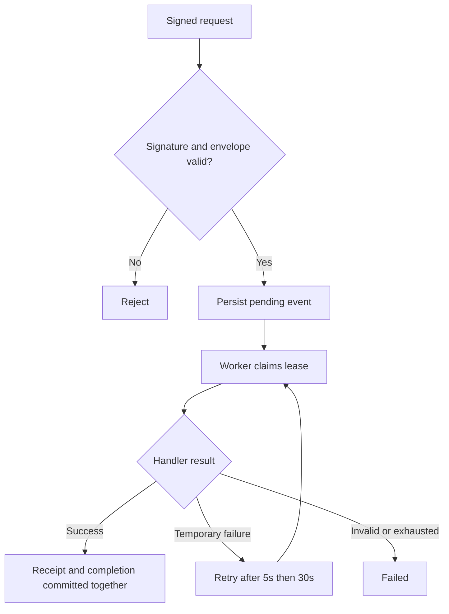

# Webhook Processing Lab

A small Rails API that accepts signed events and processes them outside the request. The example handler records a synthetic invoice receipt. There are no real payments or external API calls.

This is an independent portfolio project. It contains no employer or client code, data, or internal designs.

## Why this exists

Webhook delivery is unreliable by design: a sender may deliver twice, arrive late, or retry while a worker is restarting. This project keeps those cases visible instead of hiding them behind a happy-path endpoint.

## Run locally

Requires Ruby 3.2+ and a working SQLite development library. The checked-in lockfile pins dependencies.

```sh
bundle install
export WEBHOOK_SECRET="$(ruby -rsecurerandom -e 'puts SecureRandom.hex(32)')"
export ADMIN_TOKEN="$(ruby -rsecurerandom -e 'puts SecureRandom.hex(32)')"
bundle exec rails db:prepare
bundle exec rails server
```

In another terminal, using the same environment variables:

```sh
bundle exec rails webhooks:work
```

In a third terminal, using the same webhook secret:

```sh
ruby script/send_sample.rb evt_demo_001
ruby script/send_sample.rb evt_demo_001
```

The first request returns `202` with an internal event ID. The second returns `200` and `duplicate: true`. Once the worker runs, inspect the status:

```sh
curl -H "Authorization: Bearer $ADMIN_TOKEN" http://127.0.0.1:3000/events/1
```

Use the ID actually returned by your first request. Do not commit secrets. `.env.example` documents the required variables; Rails does not automatically load it.

## Request format

`POST /webhooks/sample` accepts the following JSON envelope:

```json
{"id":"evt_demo_001","type":"invoice.paid","data":{"invoice_id":"inv_demo","amount_cents":2500,"currency":"USD"}}
```

The `X-Webhook-Signature` header is `t=UNIX_SECONDS,v1=HEX_DIGEST`. Compute the digest with HMAC-SHA256 over `timestamp.raw_request_body`. This is a deliberately small demo protocol, not an implementation of Stripe's signature format. Sign the exact bytes being sent.

Signatures outside a five-minute window are rejected. A database unique index deduplicates event IDs. Reusing an ID with different raw bytes returns `409`; even semantically identical JSON with different whitespace is a conflict.

## Processing



The event table doubles as the durable work queue. The request does not need to enqueue into a second system after committing, so a crash between persistence and enqueue cannot strand a new event. The worker polls every half second when idle.

A conditional update claims an event and assigns a 60-second lease. A worker restart can reclaim an expired lease. Three attempts are allowed; an expired lease on the third attempt becomes failed.

The handler's database write and completion state use one transaction. If the handler raises after writing a receipt, both changes roll back. A separate unique index also limits each event to one receipt.

Only `InvoiceHandler::TemporaryFailure` is retried automatically. Invalid input fails immediately; unexpected errors become failed for investigation. The invoice handler itself only makes local database writes, so temporary failures are exercised through test injection rather than a public failure-simulation endpoint.

## Inspect and replay

Status and replay endpoints require the independent admin bearer token.

| Endpoint | Behaviour |
| --- | --- |
| `GET /up` | Rails process health; not a database/worker readiness check |
| `GET /events/:id` | Status, attempts and a bounded error code; excludes the payload |
| `POST /events/:id/replay` | Resets a failed event to pending; other states return `409` |

```sh
curl -X POST -H "Authorization: Bearer $ADMIN_TOKEN" http://127.0.0.1:3000/events/1/replay
```

Replay keeps the original payload. It is useful after fixing a handler or recovering from a temporary failure; replay alone cannot repair invalid input. Only one concurrent replay request can reset a failed event.

## Tests

```sh
RAILS_ENV=test bundle exec rails db:prepare
RAILS_ENV=test bundle exec rails zeitwerk:check
bundle exec rspec
```

The tests cover tampering, expired signatures, duplicate IDs, conflicting payloads, malformed input, transactional rollback, delayed retries, exhausted attempts, expired leases, admin authentication and replay rules. GitHub Actions runs the same checks.

## Boundaries

- Intended for local evaluation with one worker and a modest queue. It has not been load-tested or validated for multiple worker processes. SQLite write contention and polling are deliberate tradeoffs for a simple setup.
- Receipt deduplication is per event ID, not per invoice. Different event IDs referencing the same invoice are separate events.
- Database transactions protect the local receipt write. They cannot make an external payment or email exactly once. An external handler would need its own idempotency contract and timeouts.
- The handler must remain short. There is no lease heartbeat for long-running work.
- The 64 KiB check happens after Rails reads the request; a deployed reverse proxy must enforce a body-size limit before buffering it.
- Stored payloads have no automatic retention policy. Use synthetic data only.
- No UI, user accounts, per-sender secrets, rate limiting or production deployment is included. Production would need HTTPS, secret rotation, monitoring, backups and an appropriate queue/database configuration.

## References

- [Rails API applications](https://guides.rubyonrails.org/api_app.html)
- [Active Record transactions](https://api.rubyonrails.org/classes/ActiveRecord/Transactions/ClassMethods.html)
- [GitHub Actions for Ruby](https://docs.github.com/en/actions/use-cases-and-examples/building-and-testing/building-and-testing-ruby)
